# where quantization hurts

### 배경

[meta 논문](https://arxiv.org/abs/2606.00206)은 양자화 모델이 고엔트로피 위치에서 overthinking 단어를 더 자주 골라 reasoning이 길어진다고 봄. 그래서 학습 없이 이 단어들의 logit에 penalty를 줘, gptq, awq 3, 4비트에서 정확도를 대부분 유지하며 길이를 줄임.

[reqat](https://arxiv.org/abs/2606.15682)는 저엔트로피 위치에서 숫자 같은 토큰의 확률이 퍼져 잘못 샘플링되는 것을 정확도 하락의 원인으로 봄. 근거는 두 가지. r1-qwen-14b mxfp4 w4a16에서 저엔트로피 위치만 bf16으로 샘플링하면 고엔트로피 위치보다 2배 넘게 맞힘. logit에 노이즈를 넣으면 aime-2025에서 저엔트로피 위치가 더 민감함.

두 주장을 직접 확인하고, qat로 길이와 정확도를 회복할 수 있는지 봄.

### 요약

- 양자화는 주로 고엔트로피 위치를 바꿈.
- 반복과 길이 증가도 고엔트로피 위치에서 생김. 상위 10%만 bf16으로 샘플링해도 반복은 대부분 회복.
- overthinking 단어 변화는 모델마다 다름. 공통점은 확인 단어 감소.
- reqat 말대로 숫자 확률은 퍼짐. 다만 같은 비율이면 저엔트로피 위치가 무작위 위치보다 덜 회복. 저엔트로피 위치가 정확도를 좌우한다고 보긴 어려움.
- qat kd는 반복과 길이는 회복. 정확도는 일부만 회복.
- 엔트로피 가중 효과는 작음.
- on-policy로 학습해도 정확도는 더 회복되지 않음.
- scale을 함께 학습(lsq)해도 마찬가지.

### 한계

- qwen3 0.6b, 1.7b와 math500으로만 실험.
- reqat와 모델(r1-qwen-14b), 평가 규모가 달라 직접 비교는 어려움.
- 일부 설정은 seed 0만, 한 모델에서만 봄(mxfp4는 1.7b). qat kd는 0.6b만 정리.

### 양자화에 따른 reasoning 변화

#### 실험 설정

모델은 qwen3 0.6b, 1.7b thinking. 양자화는 meta 논문을 따라 gptq, weight-only, group size 128. 3비트는 두 모델 모두 반복이 폭발해 4비트로 함. calibration은 numinamath-1.5 128문제의 bf16 reasoning. math500과 겹칠 수 있는 문제 등은 제외.

평가는 math500, temperature 0.6, top-p 0.95, top-k 20, 최대 32768 토큰, seed 3개. 채점은 \</think> 뒤 \boxed{}를 math-verify로 비교. 반복은 출력 끝에서 200~150글자 사이의 50글자가 그 앞에서 5번 이상 나온 경우. 길이는 문제별 bf16 대비 길이 비율의 중앙값. 잘린 출력이 섞이지 않게 bf16과 gptq가 모두 맞힌 문제만 씀.

단어는 bf16이 맞힌 문제를 gptq도 맞힌 경우와 gptq만 틀린 경우로 나눠 봄. 잘린 출력은 대부분 반복이라 제외. 문제마다 reasoning 1000토큰당 빈도를 구해 평균 내고, bf16 대비 가장 많이 늘어난 단어와 줄어든 단어를 봄.

meta 논문의 overthinking 단어는 둘로 묶음. 의심 단어는 wait, but, however, hmm, wrong. 분기 단어는 alternatively, maybe, perhaps. verify, confirm, remember, sure는 확인 단어로 묶음.

#### 결과

figures

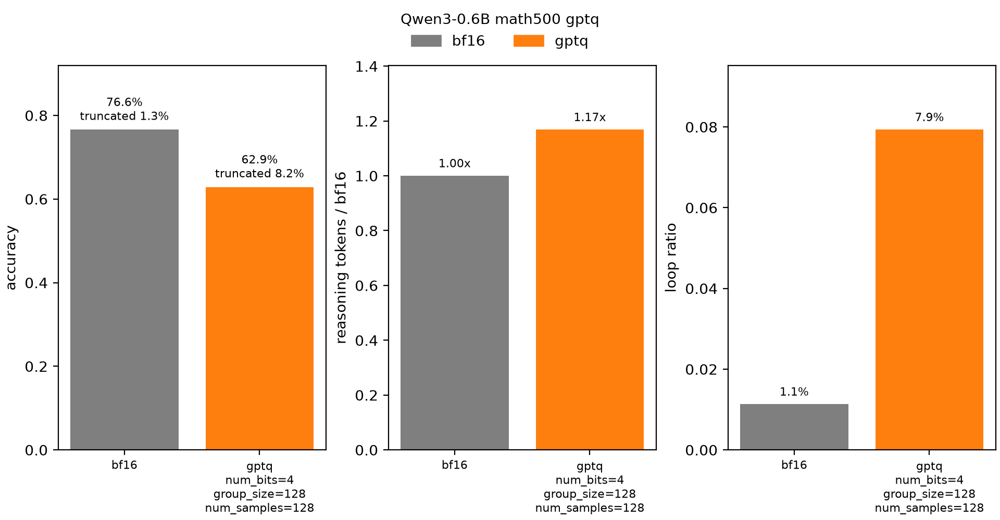

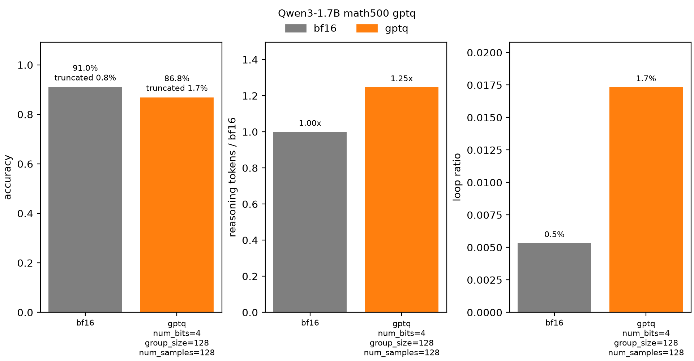

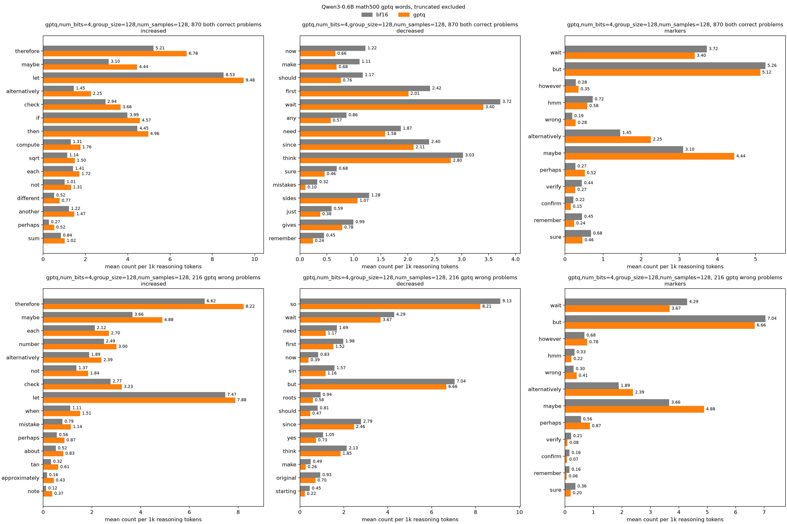

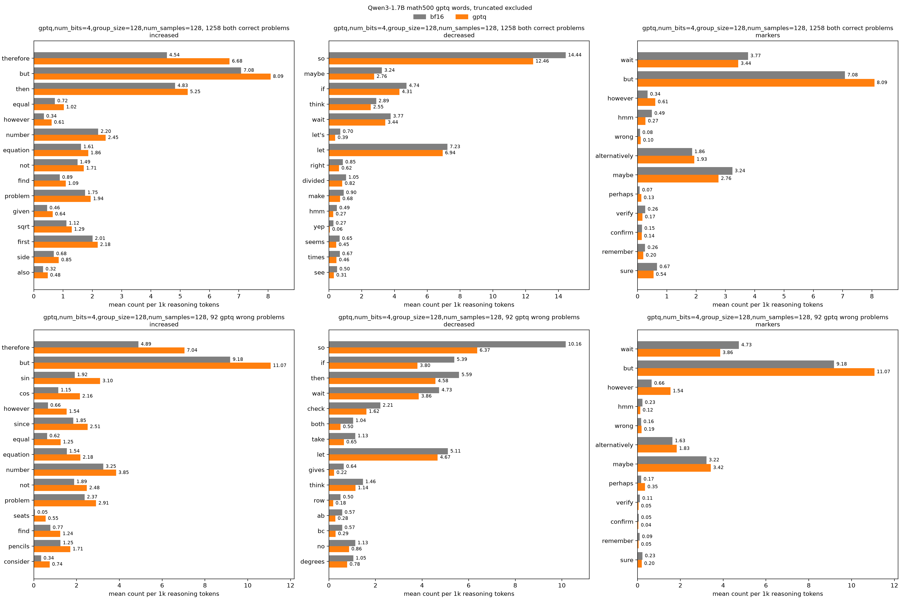

gptq는 두 모델 모두 정확도가 떨어짐(0.6b 76.6%→62.9%, 1.7b 91.0%→86.8%). 반복(1.1%→7.9%, 0.5%→1.7%)과 길이(1.17배, 1.25배)는 늘어남. 1.7b는 반복이 적은데도 길이가 더 늘어남.

확인 단어는 두 모델 모두 줄어듦. 분기 단어와 의심 단어는 모델마다 방향이 다름(maybe 0.6b 3.10→4.44, 1.7b 3.24→2.76 / but은 1.7b에서만 7.08→8.09).

> gptq로 반복이 늘거나 풀이가 길어져 reasoning이 길어짐. 다만 단어 변화가 모델마다 달라 meta 논문의 주장은 보류.

### 위치별 분포 변화

#### 실험 설정

앞의 변화가 다음 토큰 분포에서 실제로 어떻게 나타나는지, teacher forcing으로 같은 문맥에서 bf16과 gptq를 비교. 입력은 seed 0에서 bf16이 맞힌 reasoning. 고엔트로피 위치는 meta 논문처럼 bf16 엔트로피 상위 20%.

확률이 퍼지는 정도는 reqat처럼 tail mass로 봄. tail mass는 bf16 top-1 이외의 토큰이 샘플링될 확률. 토큰 종류는 숫자, 기호, 알파벳, 나머지로 나눔. 단어는 고엔트로피 위치에서 bf16과 gptq가 top-1으로 고른 토큰을 앞과 같은 기준으로 셈.

#### 결과

figures

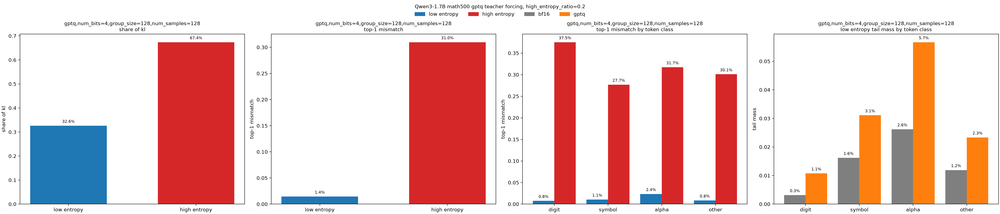

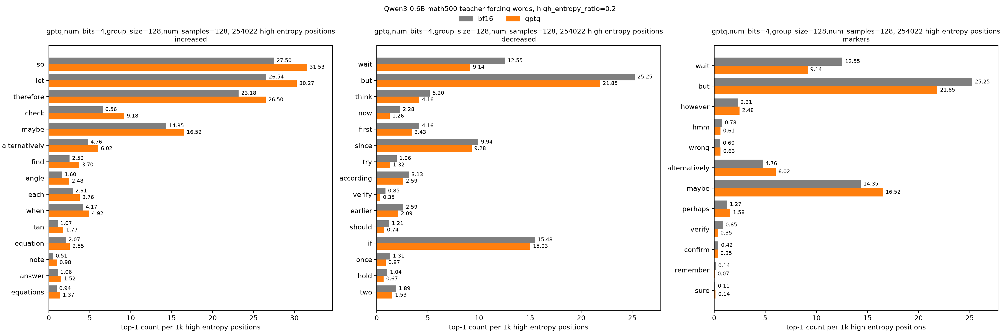

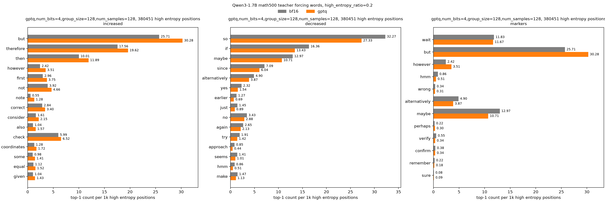

고엔트로피 위치는 20%뿐이지만 kl의 대부분을 차지(0.6b 61%, 1.7b 67%). top-1 불일치도 고엔트로피 위치가 훨씬 큼(28.8% 대 2.5%, 31.0% 대 1.4%). 토큰 종류별로 나눠도 마찬가지(저엔트로피 4% 미만, 고엔트로피 23~38%). 변화를 가르는 건 토큰 종류가 아니라 엔트로피.

저엔트로피 위치의 tail mass는 두 모델 모두 숫자에서 비율로 가장 크게 늘어남(0.6b 1.9%→2.8%, 1.7b 0.3%→1.1%). 다만 늘어난 크기는 0.8~0.9%p로 작음. 그래도 숫자 위치마다 쌓일 수 있어, 정확도 영향은 다음 routing 실험에서 봄.

단어는 앞의 생성 결과와 같은 방향으로 바뀜.

> 양자화는 주로 고엔트로피 위치를 바꿈(meta 논문과 같음). 다만 바뀌는 단어는 모델마다 다름. 숫자 확률이 퍼지는 것도 맞음(reqat와 같음). 영향은 크기만으로 판단하기 어려움.

### 위치별 bf16 샘플링 회복

#### 실험 설정

reqat 3.2절처럼 gptq로 생성하면서 일부 위치만 bf16으로 샘플링하는 routing으로 봄. high는 bf16 엔트로피 상위, low는 하위, random은 무작위 위치를 bf16으로 샘플링. 엔트로피 경계는 teacher forcing의 bf16 엔트로피로 미리 정함.

high와 random은 10%, 20%, low는 20%, 80%를 봄. low 80%는 reqat가 저엔트로피 위치 약 75%를 bf16으로 샘플링한 것에 맞춤. 같은 비율끼리 비교하려고 0.6b에서만 random 80%도 봄. low 20%, low 80%, random 80%는 seed 0만. 평가는 앞과 같음.

1.7b는 reqat와 같은 mxfp4 w4a16에서도 봄. high 20%, random 20%, low 80%, random 80%, seed 3개. mxfp4는 ocp mx 규격(32개 묶음, e2m1).

#### 결과

figures

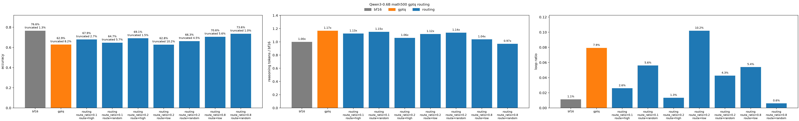

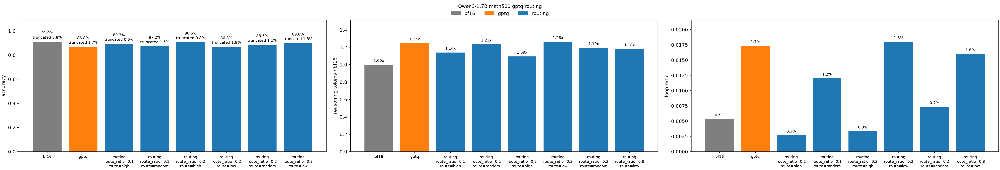

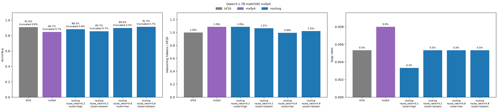

high 20%는 두 모델 모두 반복(0.6b 7.9%→1.3%, 1.7b 1.7%→0.3%)과 길이(1.06배, 1.09배)를 bf16 수준으로 회복. 정확도도 random 20%보다 더 회복(69.1% 대 66.3%, 90.6% 대 88.5%). high 10%도 비슷하게 효과적(+5.0%p, +2.5%p). random 10%는 회복이 작음(+1.8%p, +0.4%p).

low 20%는 정확도가 gptq와 거의 같음(62.8%, 86.8%). 하위 20%는 엔트로피가 거의 0이라 bf16과 gptq가 어차피 같은 토큰을 고름.

low 80%는 정확도를 크게 회복(+7.7%p, +3.0%p). 다만 0.6b에서는 random 80%보다 정확도가 낮음(70.6% 대 73.6%). 반복도 많음(5.4% 대 0.6%). 1.7b에서는 high 20%보다도 낮음(89.8% 대 90.6%).

mxfp4도 비슷한 경향. high 20%가 random 20%보다 더 회복(+3.6%p 대 +1.0%p). low 80%는 high 20%보다 높음(89.9% 대 88.3%). 다만 random 80%보다는 낮음(89.9% 대 91.5%).

> 반복과 길이는 고엔트로피 위치가 좌우. 정확도도 같은 비율이면 고엔트로피 위치가 무작위 위치보다 더 회복. low 80%가 high 20%보다 높은 reqat 결과는 0.6b gptq와 1.7b mxfp4에서만 재현. 이것도 bf16으로 샘플링한 위치가 4배 많아서. 같은 비율의 random 80%보다는 낮음.

### qat kd 엔트로피 가중 학습

#### 실험 설정

앞의 qwen3 0.6b gptq 모델에서 weight만 ste로 학습. 데이터는 numinamath-1.5 2048문제를 bf16이 최대 8192 토큰까지 푼 reasoning. loss는 bf16 분포와의 kl. bf16 엔트로피 상위 20% 위치에 가중을 주며, 가중 1(가중 없음)과 가중 3을 비교. optimizer는 adamw, batch 8, 1 epoch, learning rate 1e-4(1e-5는 학습 부족, 2e-4부터 발산). 평가는 앞과 같음.

#### 결과

figures

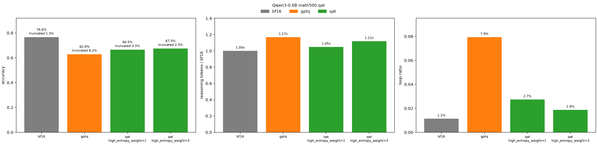

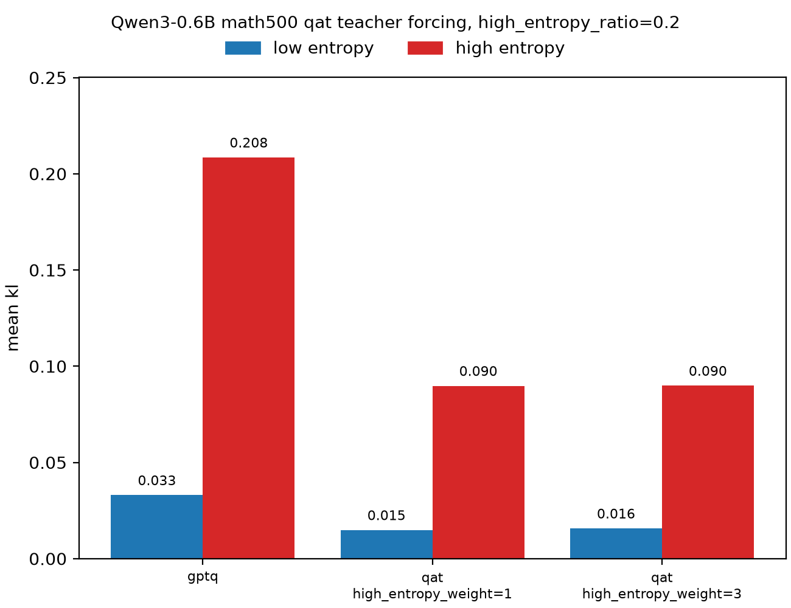

가중 1은 반복(7.9%→2.7%)과 길이(1.17배→1.05배)를 크게 회복. 다만 정확도는 일부만 회복(62.9%→66.5%).

가중 3은 가중 1보다 정확도가 조금 높지만 차이 작음(67.5% 대 66.5%). 길이는 덜 회복(1.12배). teacher forcing의 고엔트로피 kl도 같음(0.090 대 0.090). 가중을 3배로 줘도 고엔트로피 위치가 더 맞춰지지 않음.

> qat kd로 반복과 길이는 회복. 정확도는 일부만 회복. 엔트로피 가중은 효과가 작고, 고엔트로피 kl도 줄이지 못함.

### on-policy qat kd 학습

#### 실험 설정

엔트로피 가중으로는 teacher forcing의 고엔트로피 kl을 줄이지 못함. bf16 reasoning이 gptq가 실제로 생성하는 문맥과 달라서일 수 있음. 그래서 gptq reasoning으로 학습하는 on-policy로 봄.

앞의 qat kd에서 데이터만 바꿈. 같은 numinamath-1.5 2048문제를 gptq가 최대 8192 토큰까지 푼 reasoning. 가중은 1과 3. 엔트로피 경계는 학습 데이터 256개의 bf16 엔트로피 상위 20%로 다시 정함. 비교를 위해 bf16 reasoning(off-policy)도 같은 경계로 다시 학습. seed 0만. 평가는 앞과 같음.

#### 결과

figures

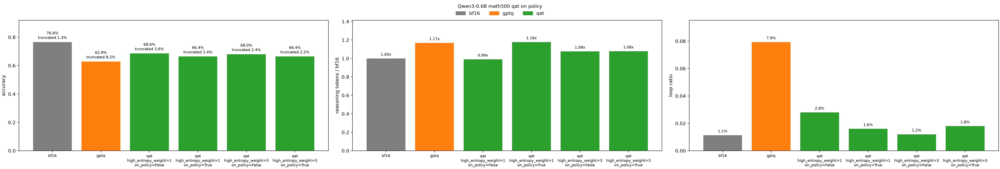

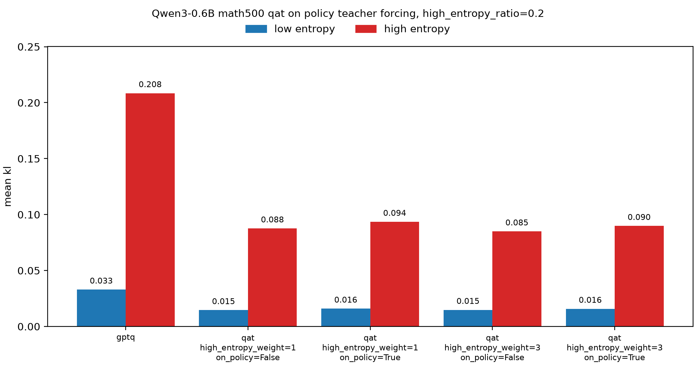

on-policy는 정확도를 더 회복하지 못함(가중 1 66.4% 대 off-policy 68.6%, 가중 3 66.4% 대 68.0%). 반복(1.6% 대 2.8%, 1.8% 대 1.2%)과 길이(1.18배 대 0.99배, 1.08배 대 1.08배)도 방향이 일정하지 않음.

teacher forcing의 고엔트로피 kl도 비슷함(0.094 대 0.088, 0.090 대 0.085).

> on-policy로도 정확도와 고엔트로피 kl은 회복되지 않음.

### lsq qat kd 학습

#### 실험 설정

on-policy로도 회복되지 않음. 학습 문맥보다 scale과 zero를 고정한 표현력이 한계일 수 있음. 그래서 lsq처럼 scale도 학습함.

앞의 qat kd(off-policy, 가중 1)에서 zero만 고정하고 weight와 scale을 학습. ste는 round에만 써서 scale에도 기울기가 감. scale learning rate는 1e-6과 1e-5(weight는 1e-4). 1e-4는 발산해서 뺌. seed 0만. 평가는 앞과 같음.

#### 결과

figures

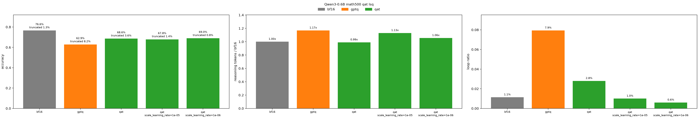

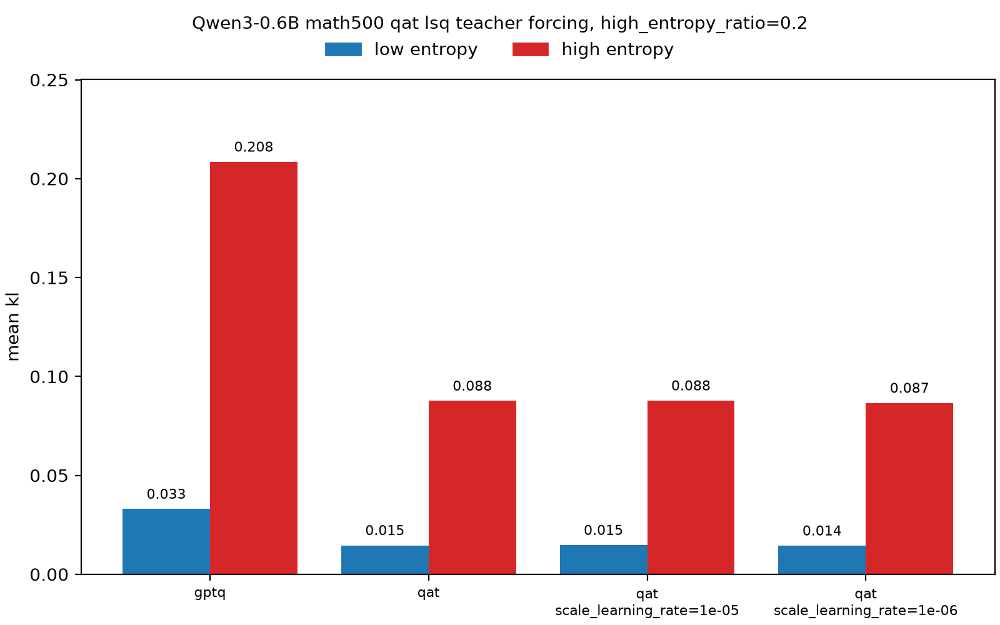

scale을 학습해도 정확도는 그대로(1e-6 69.0%, 1e-5 67.8% 대 scale 고정 68.6%). scale도 거의 움직이지 않음(중앙값 0.1%, 1.1%).

teacher forcing의 고엔트로피 kl도 비슷함(0.087, 0.088 대 0.088).

> scale을 학습해도 정확도와 고엔트로피 kl은 회복되지 않음.

