# where quantization hurts

## 배경

[meta 논문](https://arxiv.org/abs/2606.00206)은 양자화 모델이 고엔트로피 위치에서 wait, but, alternatively 같은 단어를 더 자주 골라 reasoning이 길어진다고 주장. 한편 [reqat](https://arxiv.org/abs/2606.15682)는 양자화로 저엔트로피 위치에서 숫자 같은 토큰의 확률이 퍼져 잘못 샘플링되는 것이 정확도 하락의 원인이라고 주장.

두 주장이 맞다면 양자화는 고엔트로피 위치에서 길이를, 저엔트로피 위치에서 정확도를 해침. 그래서 먼저 두 주장이 맞는지 확인하고, qat kd에서 위치별 가중을 달리 주면 길이와 정확도 하락을 함께 줄일 수 있는지 봄.

## 요약

- 양자화는 주로 고엔트로피 위치를 바꿈.
- 반복과 길이 증가도 고엔트로피 위치에서 생김.
- 숫자 확률이 퍼진다는 reqat 주장은 맞음.
- 숫자 위치의 tail mass는 1%p 안팎 늘어나지만, 숫자 위치마다 쌓일 수 있어 크기만으로는 영향을 판단하기 어려움.
- 같은 비율이면 고엔트로피 위치는 무작위 위치보다 정확도를 더 회복함.
- 같은 비율이면 저엔트로피 위치는 무작위 위치보다 정확도를 덜 회복함.
- reqat routing에서 저엔트로피 위치가 더 회복한 것은 bf16으로 샘플링한 위치가 더 많아서임.
- qat kd는 반복과 길이는 거의 회복하지만 정확도는 일부만 회복함.
- 엔트로피 가중의 효과는 작음.

## 한계

- qwen3 0.6b, 1.7b와 math500으로만 실험함.
- mxfp4는 1.7b만 봄.
- gptq routing의 low 0.2, low 0.8, random 0.8은 seed 0만 있음.
- 1.7b에는 gptq random 0.8이 없음.
- reqat와 모델(r1-qwen-14b 대 qwen3 0.6b, 1.7b)과 평가 규모가 달라 직접 비교하기 어려움.
- 엔트로피 경계는 teacher forcing의 bf16 엔트로피로 한 번 정한 고정값이라, routing과 qat kd에서 실제로 보는 문맥의 분포와 다를 수 있음.

## 관련 연구

[quantized reasoning models think they need to think longer](https://arxiv.org/abs/2606.00206)(meta 논문)는 고엔트로피 위치에서 특정 단어를 더 자주 고르는 것이 reasoning이 길어지는 원인이라고 봄. 그래서 학습 없이 해당 단어들의 logit에 penalty를 줌. gptq, awq 3, 4비트에서 길이가 줄고, 정확도는 대부분 유지되거나 오름. 여기서는 그 단어들이 실제로 늘어나는지와, penalty 대신 qat kd로 고엔트로피 위치를 학습하면 회복되는지 봄.

[reqat](https://arxiv.org/abs/2606.15682)는 양자화로 저엔트로피 위치의 확률이 퍼져 잘못 샘플링되는 것이 정확도 하락의 원인이라고 봄. 근거로 r1-qwen-14b, mxfp4 w4a16에서 어려운 문제 하나를 8번 생성해, 저엔트로피 약 75%를 bf16으로 샘플링하면 7번, 고엔트로피 약 25%면 3번 맞힘(bf16만 6번, 양자화 모델만 1번). 또 엔트로피 상위 25%와 하위 25%에 logit 노이즈를 넣어 aime-2025에서 비교해, 하위 25%에 넣을 때 정확도가 크게 떨어짐. 그래서 qat loss에 저엔트로피 위치의 엔트로피를 낮추는 항을 더해, r1-qwen-14b에서는 같은 학습량의 bf16 fine-tuning과 같거나 높아짐. 여기서는 숫자 확률이 퍼지는 크기를 재고, routing을 같은 비율의 random과 비교해 실제 양자화 모델로 같은 mxfp4에서도 다시 봄.

[tsld](https://arxiv.org/abs/2308.06744)는 qat kd에서 teacher가 확신하는 위치는 정답 loss와 kd의 목표가 겹쳐, 그 위치에 과적합된다고 봄. 그래서 teacher가 정답에 준 ce로 위치별 가중을 줘, teacher가 덜 확신하는 위치에 가중을 더 줌. perplexity와 gsm8k가 조금 나아짐. 여기서도 고엔트로피 위치에 가중을 주지만, 과적합을 막으려는 것이 아니라 양자화 영향이 몰린 위치를 더 학습하려는 것.

## 양자화가 reasoning을 어떻게 바꾸는지

### 실험 설정

모델은 qwen3 0.6b, 1.7b thinking 모드. 양자화는 meta 논문을 따라 gptq, weight-only, group size 128. 3비트는 두 모델 모두 반복이 폭발해 4비트를 씀. calibration은 numinamath-1.5 문제 128개를 bf16이 푼 reasoning이고, math500과 겹칠 수 있는 synthetic과 증명, 객관식, 불완전한 문제는 제외.

평가는 math500, temperature 0.6, top-p 0.95, top-k 20, 최대 32768 토큰, seed 3개. 채점은 \</think> 뒤의 \boxed{}를 math-verify로 비교. 반복은 출력 끝부분의 50글자가 그 앞에서 5번 이상 나오는 경우. 길이는 최대 길이에서 잘린 출력이 섞이지 않도록, bf16과 양자화 모델이 둘 다 맞힌 문제에서 bf16 대비 문제별 길이 비율의 중앙값으로 비교.

단어는 bf16이 맞힌 문제를 gptq도 맞힌 경우와 gptq만 틀린 경우로 나누고, 잘린 출력은 대부분 반복이라 제외. 문제마다 reasoning 1000 토큰당 빈도로 바꿔 평균 내고, bf16보다 가장 많이 늘어난 단어와 줄어든 단어를 봄. meta 논문의 overthinking 단어 중 wait, but, however, hmm, wrong은 의심 단어, alternatively, maybe, perhaps는 분기 단어로 묶고, verify, confirm, remember, sure는 확인 단어로 따로 정함.

### 결과

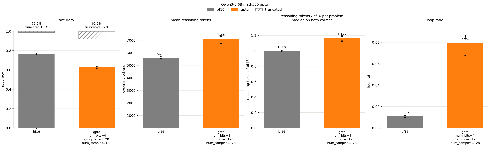

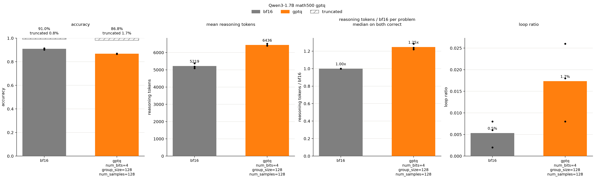

gptq는 두 모델 모두 정확도가 떨어지고(0.6b 76.6%→62.9%, 1.7b 91.0%→86.8%) 반복이 늘며(1.1%→7.9%, 0.5%→1.7%), 길이도 1.17배와 1.25배로 늘어남. 1.7b는 반복은 적지만 길이는 더 늘어남.

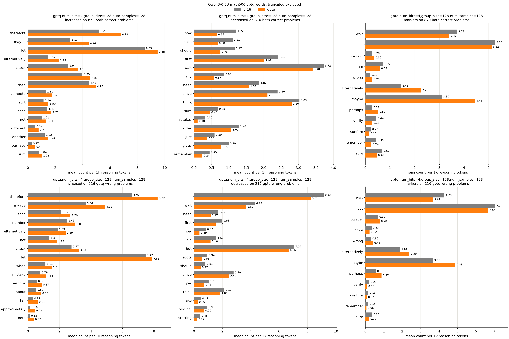

확인 단어 verify, confirm, remember, sure는 두 모델 모두 줄어듦. 반면 maybe는 0.6b에서 늘고(3.10→4.44) 1.7b에서 줄며(3.24→2.76), but은 1.7b에서만 늘어(7.08→8.09) 분기 단어와 의심 단어는 모델마다 방향이 다름.

> gptq는 반복에 빠지거나 풀면서 길어지는 두 방식으로 reasoning이 길어짐. 다만 단어 변화는 모델마다 달라 overthinking 단어가 늘어난다는 meta 논문의 주장은 일부만 맞고, 두 모델에 공통인 것은 확인 단어가 줄어드는 것.

## 양자화가 어느 위치의 분포를 바꾸는지

### 실험 설정

bf16 reasoning을 bf16과 gptq에 똑같이 넣는 teacher forcing으로, 같은 문맥에서 두 모델의 다음 토큰 분포를 비교. 입력은 seed 0에서 bf16이 맞힌 reasoning이고, 고엔트로피 위치는 meta 논문과 같이 bf16 엔트로피 상위 20%.

확률이 퍼지는 정도는 reqat처럼 tail mass로 보되 bf16 top-1 이외로 샘플링될 확률로 정하고, 토큰은 실제 다음 토큰 기준으로 숫자, 기호, 알파벳, 나머지로 나눔. 단어는 고엔트로피 위치에서 두 모델이 top-1으로 고른 토큰을 앞의 math500 실험과 같은 기준으로 셈.

### 결과

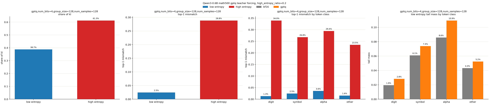

고엔트로피 위치는 전체의 20%지만 두 모델 모두 kl의 대부분을 차지하고(0.6b 61%, 1.7b 67%), top-1 불일치도 저엔트로피 위치보다 훨씬 큼(28.8% 대 2.5%, 31.0% 대 1.4%). 토큰 종류로 나눠도 top-1 불일치는 저엔트로피 위치에서 모두 4% 미만이고 고엔트로피 위치에서 23~38%라, 토큰 종류보다 엔트로피가 좌우함.

저엔트로피 위치의 tail mass는 두 모델 모두 숫자에서 비율로는 가장 크게 늘지만(0.6b 1.9%→2.8%, 1.7b 0.3%→1.1%), 늘어나는 크기는 0.8~0.9%p임. 다만 숫자 위치마다 쌓이면 작지 않을 수 있어, 정확도에 주는 영향은 다음 routing 실험으로 봄.

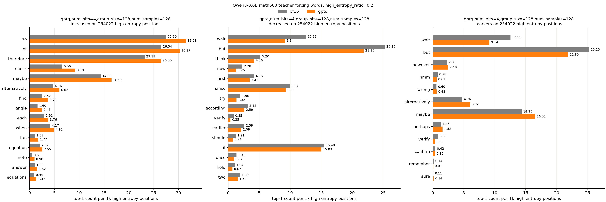

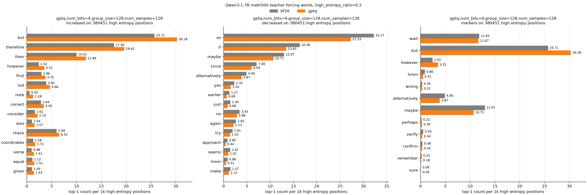

고엔트로피 위치에서 gptq가 top-1으로 고르는 단어는 생성 때와 같은 방향으로 바뀜. 0.6b는 wait, but을 덜 고르고 maybe, alternatively를 더 고르며, 1.7b는 반대로 but, however를 더 고르고 maybe를 덜 고름. 확인 단어 verify는 두 모델 모두 줄어듦.

> 양자화가 주로 고엔트로피 위치를 바꾼다는 meta 논문의 주장은 두 모델 모두 맞음. 다만 어떤 단어로 바뀌는지는 모델마다 다르고, 공통점은 확인 단어가 줄어드는 것. 숫자 확률이 퍼진다는 reqat 주장도 맞음.

## 어느 위치를 bf16으로 샘플링하면 회복되는지

### 실험 설정

gptq로 생성하면서 위치마다 bf16과 gptq 중 어느 쪽에서 샘플링할지 고르는 routing으로 봄. 방식은 reqat 3.2절 entropy-aware mixed-precision decoding과 같음. high는 bf16 엔트로피 상위 20%, low는 하위 20%, random은 무작위 20%의 위치를 bf16으로 샘플링하고, 엔트로피 경계는 teacher forcing의 bf16 엔트로피 분포로 미리 정함. high와 random은 10%도 봄. reqat는 저엔트로피 약 75%를 bf16으로 샘플링했으므로 low는 80%도 보고, 같은 비율과 비교하려고 0.6b에서는 random 80%도 봄. 평가는 앞의 math500 실험과 같고, low 0.2, low 0.8, random 0.8은 seed 0만 돌림.

### 결과

high 0.2는 두 모델 모두 반복을 bf16 수준으로 줄이고(0.6b 7.9%→1.3%, 1.7b 1.7%→0.3%), 길이도 1.06배와 1.09배로 줄이며, 정확도도 random 0.2보다 더 회복함.

high 0.1만으로도 두 모델 모두 high 0.2 회복의 대부분을 얻음. 정확도는 0.6b에서 +5.0%p(high 0.2는 +6.2%p), 1.7b에서 +2.5%p(+3.8%p) 오르고, 반복은 2.6%와 0.3%로 줄어듦. 같은 10%인 random 0.1은 회복이 작음.

low 0.2는 두 모델 모두 정확도가 gptq와 거의 같음. 하위 20%는 엔트로피가 거의 0이라 두 모델이 어차피 같은 토큰을 고르기 때문.

low 0.8은 두 모델 모두 정확도를 크게 회복하지만(0.6b +7.7%p, 1.7b +3.0%p) 반복은 남음(5.4%, 1.6%). 다만 0.6b에서 같은 80%인 random 0.8보다 정확도가 낮고(70.6% 대 73.6%) 반복도 많음(5.4% 대 0.6%). low 0.8의 회복은 bf16으로 샘플링한 위치가 많아서이고, 고엔트로피 위치를 빼면 무작위로 고를 때보다 덜 회복됨.

> 반복과 길이는 고엔트로피 위치가 좌우하고, 반복은 상위 10%만으로도 대부분 회복됨. 정확도도 같은 비율이면 고엔트로피 위치는 무작위 위치보다 더 회복하고 저엔트로피 위치는 덜 회복해, 저엔트로피 위치가 정확도를 좌우한다는 reqat의 해석과 다름.

## reqat와 같은 mxfp4에서도 같은지

### 실험 설정

reqat 3.2절 routing은 mxfp4 w4a16이라, 양자화를 맞춰 1.7b에서 다시 봄. reqat는 scale과 rounding 방식을 밝히지 않아, ocp mx 규격대로 32개씩 묶어 절댓값 최댓값의 지수에서 2를 뺀 2의 거듭제곱(e8m0)을 scale로 두고 e2m1로 round-to-nearest 함. calibration은 쓰지 않음. 엔트로피 경계는 gptq와 같은 값을 쓰고, high 0.2, random 0.2, low 0.8, random 0.8을 seed 3개로 돌림. 평가와 teacher forcing은 앞과 같음.

### 결과

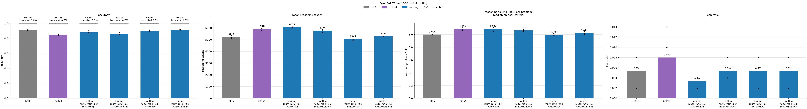

mxfp4는 gptq보다 정확도가 더 떨어지지만(91.0%→84.7%, gptq는 86.8%) 반복과 길이는 덜 늘어남(0.8%와 1.09배, gptq는 1.7%와 1.25배).

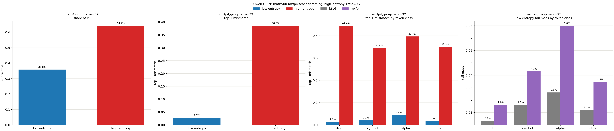

teacher forcing에서는 kl이 gptq의 두 배 가까이 되고(0.18 대 0.10), 저엔트로피 위치의 top-1 불일치(2.7% 대 1.4%)와 숫자 위치의 tail mass(0.3%→1.6%, gptq는 1.1%)도 더 큼. 고엔트로피 위치의 kl 비중은 64%로 gptq(67%)와 비슷함. mxfp4는 gptq보다 저엔트로피 위치를 더 흔듦.

high 0.2는 random 0.2보다 정확도를 더 회복함(+3.6%p 대 +1.0%p). low 0.8은 reqat처럼 high 0.2보다 정확도가 높지만(89.9% 대 88.3%), 같은 80%인 random 0.8보다는 낮고(89.9% 대 91.5%) seed 3개 모두 random 0.8이 더 높음. 0.6b gptq와 같은 방향.

> 저엔트로피 위치를 더 흔드는 mxfp4에서도 같은 비율이면 고엔트로피 위치는 무작위 위치보다 정확도를 더 회복함. reqat routing 결과는 재현되지만, 저엔트로피 위치가 더 회복한 것은 bf16으로 샘플링한 위치가 더 많아서임.

## qat kd로 rounding을 학습하면 회복되는지

### 실험 설정

앞의 gptq 모델에서 scale과 zero는 고정하고 weight만 ste로 학습. 데이터는 calibration과 같은 기준으로 고른 numinamath-1.5 문제 2048개를 bf16이 최대 8192 토큰까지 푼 reasoning. loss는 bf16 분포와의 kl이고, bf16 엔트로피 상위 20% 위치에 가중을 곱해 가중 1(가중 없음)과 가중 3을 비교. optimizer는 adamw, batch 8, 1 epoch. learning rate는 0.6b에서 1e-5는 거의 학습되지 않고 2e-4부터 발산해 1e-4로 정함. 평가는 앞의 math500, teacher forcing 실험과 같음.

### 결과

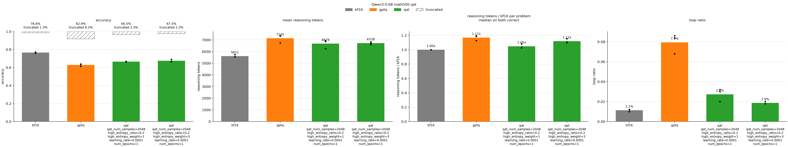

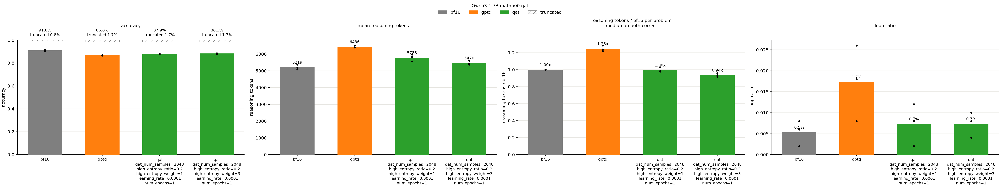

가중 1의 qat kd는 두 모델 모두 반복을 크게 줄이고(0.6b 7.9%→2.7%, 1.7b 1.7%→0.7%), 길이도 1.05배와 1.00배로 줄임. 다만 정확도는 일부만 회복함(62.9%→66.5%, 86.8%→87.9%).

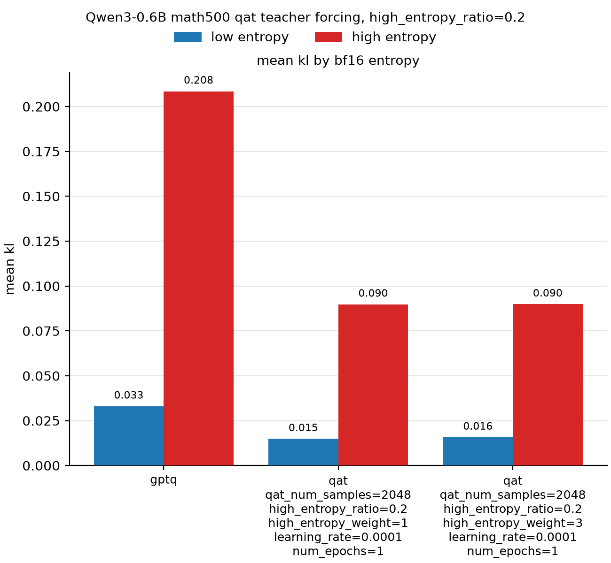

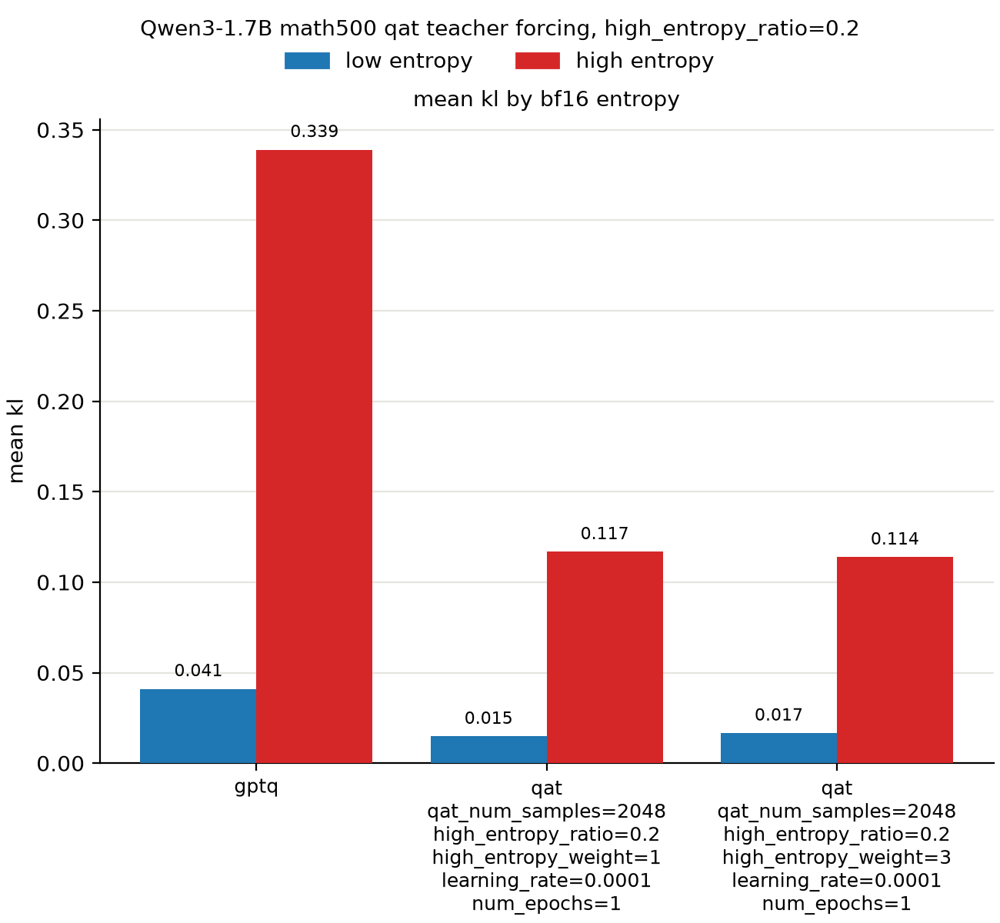

가중 3은 가중 1보다 정확도가 조금 높지만 차이가 작고(67.5% 대 66.5%, 88.3% 대 87.9%), 0.6b에서는 길이가 1.12배로 덜 줄어듦. 앞의 teacher forcing으로 잰 고엔트로피 위치의 kl도 거의 같음(0.090 대 0.090, 0.114 대 0.117). 가중을 3배로 줘도 고엔트로피 위치가 더 맞춰지지 않음.

> qat kd로는 반복이 크게 줄고 길이도 거의 회복되지만 정확도는 일부만 회복됨. 단순 엔트로피 가중의 효과는 작고, 0.6b 가중 3에서는 오히려 길이가 덜 회복됨.
